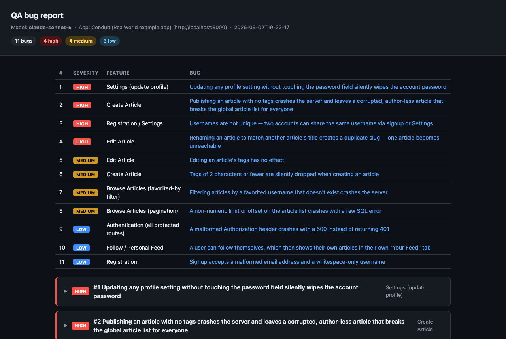

<div align="center">

# ai-qa-engineer

**A QA skill that helps coding agents test web apps and report bugs with evidence.**

[](LICENSE)
[](https://playwright.dev)
[](#supported-agents)

[Example report](https://jpita.github.io/ai-qa-engineer/examples/conduit/bug-report-2026-09-02T19-22-17-claude-sonnet-5.html) · [Quickstart](#quickstart) · [Supported agents](#supported-agents) · [Evaluate an agent](#evaluate-an-agent)

</div>

Give your agent a web app and its source code. The skill guides it through reading
the code, planning tests, checking browser flows and server responses, and writing
a report with reproduction steps and screenshots.

Use it to check sign-up, forms, search, saved data, calculations, and other features
that should work for a user. It focuses on functional correctness. Security testing
requires a separate workflow.

## What you get

- **A test plan:** cases with inputs, actions, expected results, and risk levels.
- **A bug report:** reproduced failures with expected and observed behavior,
  screenshots, and relevant server requests.
- **A coverage map:** backend routes tested and gaps that need attention.
- **Regression tests, on request:** Playwright or Cypress tests for confirmed bugs
  and high-risk cases, with evidence explaining failed tests.

The skill requires the agent to reproduce a bug before reporting it. Review the
report and its evidence to confirm that the conclusions match what was tested.

[](https://jpita.github.io/ai-qa-engineer/examples/conduit/bug-report-2026-09-02T19-22-17-claude-sonnet-5.html)

## Quickstart

This example uses Claude Code. Before starting, you need:

- Git, Node.js 20 or later, and npm.
- Claude Code installed and signed in.
- A running web app and access to its frontend and backend source code.

### 1. Install the repository helpers

```bash
git clone https://github.com/jpita/ai-qa-engineer.git
cd ai-qa-engineer
npm install
npx playwright install chromium
```

### 2. Connect a browser to Claude Code

The Playwright MCP server gives the agent tools to open pages, click, type, and
inspect browser requests. User scope makes the browser tools available when you
open Claude Code in the report folder.

```bash
claude mcp add --scope user playwright -- npx -y @playwright/mcp@latest --headless --isolated
```

### 3. Install the skill

From the repository root, link the skill into Claude Code's skills directory:

```bash
mkdir -p ~/.claude/skills/ai-qa-engineer
ln -s "$PWD/SKILL.md" ~/.claude/skills/ai-qa-engineer/SKILL.md
```

### 4. Ask the agent to test your app

Create a folder for the reports and open Claude Code there:

```bash
mkdir -p qa-results
cd qa-results
claude
```

In Claude Code, enter the following request. Replace the URL and source path with
your running app's address and the absolute path to its code:

```text
/ai-qa-engineer --url http://localhost:3000 --source /absolute/path/to/your-app
```

The source can also be a Git repository URL. If you provide only a source folder
or repository URL, the skill directs the agent to start the app before testing.
Setup still depends on the app's dependencies and configuration.

To request regression tests, add your preferred framework:

```text
/ai-qa-engineer --url http://localhost:3000 --source /absolute/path/to/your-app --tests cypress
```

Use `--tests playwright` for Playwright. If you request tests without choosing a
framework, the skill uses the app's existing framework when there is one, or
Playwright when there is no unambiguous choice.

### 5. Open the report

Look in the folder where you started Claude Code for
`bug-report-<date>-<model>.html`. Open it in a browser. The file contains the test
results, bug details, and embedded screenshots, so it can be shared as one file.

Agents can run commands with your configured permissions. Use a disposable test
app and read the [macOS sandbox guide](docs/SANDBOX-MACOS.md) when you need to
restrict access to local files.

## Supported agents

The repository includes launchers for Claude Code, Codex, Grok, Kimi,
DeepSeek through Reasonix, Antigravity, and GitHub Copilot. Each agent needs a
supported model, authentication, and working browser tools.

For another agent, supply [SKILL.md](SKILL.md) as its instructions and follow the
[agent setup guide](docs/QUICKSTART.md). Launcher model defaults and environment
overrides are configured in [scripts/models.env](scripts/models.env).

Before using a launcher, check that the agent can reach the target app through its
browser tools. The [browser preflight](docs/QUICKSTART.md#comparing-full-site-runs)
checks this against a running app. Launcher support alone does not establish that
an agent completed a QA assessment.

## How testing works

The agent reads the frontend and backend to map features and routes, then writes
a test plan covering normal use, invalid input, boundaries, persistence, and
regressions. It exercises user flows in a real browser and checks server behavior
with direct requests where appropriate.

For a suspected bug, it repeats the behavior and records the evidence. The report
states what happened, what should have happened, and how to reproduce it. Routes
that could not be tested remain visible as coverage gaps.

When regression tests are requested, the skill guides the agent to create and run
them. Failed tests are classified as an app bug, a test bug, a setup problem, or
an inconclusive result.

## Output files

| File | Contents |
| --- | --- |
| `test-plan.json` | Test cases, expected results, risk levels, and execution results |
| `findings.json` | Reproduced bugs and supporting evidence |
| `coverage.json` | Backend routes, test status, and reasons for gaps |
| `bug-report-<date>-<model>.html` | Standalone report with embedded screenshots |
| `specs/` or `cypress/e2e/` | Regression tests, when requested |
| `triage.json` | Explanations and evidence for failed regression tests |

Focused agent evaluations use a smaller [output contract](docs/EVALS.md#trial-artifacts).

## Examples

- [Conduit report](https://jpita.github.io/ai-qa-engineer/examples/conduit/bug-report-2026-09-02T19-22-17-claude-sonnet-5.html):
  inspect the report layout, reproduction steps, and screenshots. The underlying
  [findings and coverage files](examples/conduit) are included in the repository.
- [OWASP Juice Shop](examples/juice-shop): inspect a test plan, generated Playwright
  tests, and explanations of failed tests. This example covers part of the app.

## Evaluate an agent

The evaluation tools check whether an agent can identify a defect and correctly
recognize working behavior. Two small apps provide broken and fixed versions of:

- **Profile persistence:** saving a bio and checking that it survives a reload.
- **Calculation correctness:** checking that text and list inputs produce the
  expected match score, including cases where the server returns a successful response.

A passing assessment requires the correct conclusion, recorded browser activity,
matching findings, and a screenshot.

To inspect the workflow without calling an AI model, run the scripted browser
reference from the repository root:

```bash
npm run eval:demo
```

Open the `report.html` path printed by the command to inspect the conclusions and
evidence. This checks the evaluation tools; it does not measure an AI model.

| Goal | Guide |
| --- | --- |
| Evaluate an installed agent CLI | [Local evaluation setup and scoring](docs/EVALS.md) |
| Compare Claude Code and Codex in separate Docker containers | [Harbor setup and authentication](docs/HARBOR.md) |
| Inspect scores, evidence, and timings | [Local reports](docs/EVALS.md#timings-in-the-report) or [Harbor's results viewer](docs/HARBOR.md#results-and-timing) |

These tasks assess persistence and calculation behavior. They do not score
full-app coverage, report quality, or generated regression tests.

## Documentation

- [Full setup guide](docs/QUICKSTART.md): agent setup, target apps, and launchers.
- [QA skill](SKILL.md): testing instructions and report requirements.
- [Evaluation guide](docs/EVALS.md): local agent assessments and evidence checks.
- [Harbor guide](docs/HARBOR.md): container setup, authentication, and comparisons.
- [Sandbox guide](docs/SANDBOX-MACOS.md): restricting local file access on macOS.

## License

[MIT](LICENSE).
